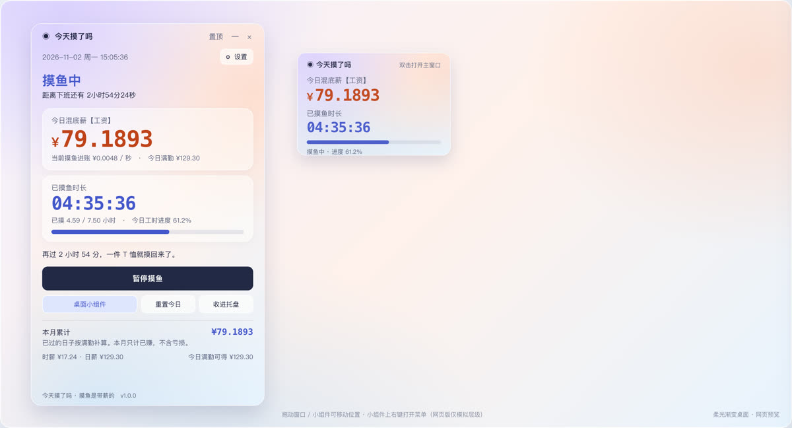

# 今天摸了吗

> **当前版本：`v1.2.0`** · 语义化版本 SemVer · [更新记录](CHANGELOG.md) · [版本规则与发布流程](docs/VERSIONING.md) · [版本号校验工具](scripts/bump_version.py)

一款 Windows 桌面软件：把「上班摸鱼」实时折算成钱。主界面只突出两项数据 —— **今日混底薪【工资】** 与 **已摸鱼时长**，两者都按真实系统时钟逐秒跳动；附带桌面小组件、系统托盘、设置页与开机自启。

| 主窗口   | 桌面小组件 |
| ----- | ----- |
| 主窗口预览 | 小组件预览 |

> 预览图在 macOS 上离屏渲染，Windows 上字体会自动切换为「微软雅黑 / Consolas」，布局一致。

> **Windows 用户直接上手**：工作区里已备好 **`今天摸了吗_Windows免安装版.zip`**，解压后双击 **`今天摸了吗.exe`** 就能运行，不用装 Python、不用装依赖、不用装 VC++ 运行库，也不会弹黑色控制台。详见[现成的免安装压缩包](#现成的免安装压缩包推荐)。

> **在 macOS 上调试？** 直接双击 `web/preview.html` 就能在浏览器里交互预览：调时间、改薪资工时、换主题、拖动小组件、查看计算中间量；双击 `web/start.command` 还能启动服务，把网页结果与真实 `core.py` 逐字段对照。详见 [十、网页预览（macOS 调试）](#十网页预览macos-调试)。

---

## 一、功能对照（依据你提供的视频）

视频里的软件叫「上班鼓励器」，7 秒全程展示主界面的实时计数。逐项还原如下：

| 视频中的元素                   | 本软件                                |
| ------------------------ | ---------------------------------- |
| 今日已赚 `¥79.1865`，每秒跳动     | **今日混底薪【工资】** `¥79.1923`，实时到 4 位小数 |
| 已工作 `4.59 / 7.50 小时`     | **已摸鱼时长** `04:35:37` + 工时进度条       |
| 距离下班还有 `2小时54分24秒`       | 保留，实时倒计时                           |
| 当前赚钱速度 `¥0.0048 / 秒`     | 当前摸鱼进账 `¥0.0048 / 秒`               |
| 再过 2 小时 53 分，一件 T 恤就赚回来了 | 同类趣味文案，目标金额可改、可轮换                  |
| 关闭计时器                    | 暂停摸鱼 / 继续摸鱼（按时间区间精确扣减）             |
| 今日工时进度 `61.2%`           | 保留                                 |
| 本月累计 / 时薪 / 今日满勤可得       | 保留，且「已过的工作日按满勤补算」                  |
| 右上角「设置」                  | 完整设置页（薪资 / 工时 / 节假日 / 主题 / 小组件）    |
| 视频未展示                    | 桌面小组件、系统托盘、开机自启、单实例、数据导出           |

**默认参数完全还原视频**（2026-11-02 周一 15:05:35）：

| 项       | 值                  | 推导                                  |
| ------- | ------------------ | ----------------------------------- |
| 上班 / 下班 | 09:00 / 18:00      | 15:05:36 + 2小时54分24秒 = 18:00        |
| 午休      | 12:00 – 13:30（不计薪） | 9–12 + 13:30–15:05 = 4小时35分 = 4.59h |
| 每日有效工时  | 7.50 小时            | 4.59 ÷ 61.2% ≈ 7.50                 |
| 日薪 / 时薪 | ¥129.30 / ¥17.24   | 129.30 ÷ 7.5 = 17.24                |
| 每秒进账    | ¥0.0048            | 17.24 ÷ 3600                        |

想直接看到视频里的数字，可用：`python main.py --at 2026-11-02T15:05:36`

---

## 二、运行方式 A：直接运行源码（不改代码）

**环境**：Windows 10 / 11，Python 3.10 及以上（安装时勾选 *Add Python to PATH*）。

```bat
:: 1. 安装依赖（只需一次）
pip install -r requirements.txt

:: 2. 启动（二选一）
run.bat
python main.py
```

`run.bat` 会优先用 `pythonw.exe` 启动，不会弹出黑色控制台窗口。常用参数：

| 参数                         | 作用                        |
| -------------------------- | ------------------------- |
| `--minimized`              | 启动后只驻留系统托盘，不弹主窗口          |
| `--at 2026-11-02T15:05:36` | 指定演示时间，用于复现参考数据（数字仍会实时增长） |
| `--quit-after 5`           | 5 秒后自动退出，用于冒烟测试           |

---

## 三、运行方式 B：编译 / 打包成单文件 EXE

在本项目目录里 **双击 `build.bat`**（Windows 上执行）即可，它会自动装依赖、生成图标、调用 PyInstaller：

```bat
build.bat
```

等价的手动命令：

```bat
pip install -r requirements.txt
pip install "pyinstaller>=6.0"
python make_assets.py
python -m PyInstaller --noconfirm --clean app.spec
```

产物在 `dist\`：

- `今天摸了吗.exe` —— 中文名主程序（名称与界面统一）
- `TodayMoYu.exe` —— 同文件的 ASCII 名副本，方便写脚本 / 快捷方式 / 排障

`app.spec` 里已设好：单文件、无控制台窗口、内嵌 `resources\app.ico` 图标、打包 Rainmeter 皮肤、隐藏 `QtNetwork` 依赖、关闭 UPX（避免 Qt 插件被杀软误报）。

> **说明**：本仓库是在 macOS 上开发并验证的，Windows EXE 需要在 Windows 机器上执行 `build.bat` 生成（PyInstaller 不支持跨平台产出 Windows 可执行文件）。源码本身跨平台可跑，Windows 专属能力会自动启用。
>
> 首次被 Defender / 杀软拦截属于 PyInstaller 单文件程序的常见误报，可加入信任或改用「方式 A」源码运行。

### 现成的免安装压缩包（推荐）

已经打好，**不需要 Windows 机器、不需要 Python、不需要联网、不需要管理员权限**：

| 交付文件 | 说明 |
| --- | --- |
| `今天摸了吗_Windows免安装版.zip` | 约 81 MB，解压后约 200 MB，Windows 10/11 64 位 |
| `今天摸了吗_Windows免安装版.zip.sha256` | SHA-256 校验值 |

**使用**：解压到任意目录（保持目录结构）→ 双击 **`今天摸了吗.exe`**。这是用 Go 交叉编译的 Windows GUI 可执行文件（`PE32+ / x86-64`，内嵌图标），双击后唤起同目录 `runtime\pythonw.exe` 运行主程序，无控制台闪屏；中文名若显示乱码可双击 `TodayMoYu.exe`（内容完全相同）。排障用 `Run-Debug.bat`，双击 `SelfCheck.bat` 可逐个检查 Python / Qt / 项目模块是否都能导入，`Run.bat` 是等价的批处理入口。

> exe 是**启动器**，需要同目录的 `runtime\`（Python 运行时与 Qt 库都在里面）。如果要「单文件、可脱离目录」的 exe，请在 Windows 上执行项目里的 `build.bat` —— PyInstaller 只能在 Windows 上产出 Windows 可执行文件。启动器源码在 `launcher/main.go`，`GOOS=windows GOARCH=amd64 go build -ldflags="-H windowsgui -s -w"` 即可重新编译。

包里内置了 Python 3.11 embeddable 运行时、PySide6 6.8.3（Qt 6.8）Windows 版、Qt 平台插件 `qwindows.dll` 以及 VC++ 运行库（`msvcp140.dll` 等，来自 Qt wheel），并配好 `python311._pth`。功能与源码版完全一致：主窗口、实时折算、桌面小组件、托盘、开机自启、调休、Rainmeter 数据导出都在。

需要重新生成时，在 macOS / Linux 上执行 `python3 build_portable.py`（会自动下载依赖、组装、静态校验、打 zip）；脚本位于项目根目录。

---

## 四、添加桌面小组件（三种方式）

### 方式 1：内置桌面贴片（推荐，零依赖）

1. 主窗口点击 **「桌面小组件」** 按钮，或右键系统托盘图标 → **「显示桌面小组件」**。
2. 小组件会以半透明圆角窗口出现在屏幕右上角，实时显示 **今日混底薪【工资】** 和 **已摸鱼时长**，外加进度条与状态。
3. **拖动**任意位置可移动，**双击**打开主窗口，**右键**打开菜单。
4. 想每次开机都有：设置 → 外观与系统 → 勾选「启动时显示桌面小组件」+「开机自动启动」。

右键菜单提供：窗口置顶、贴到桌面、大小（80%–150%）、透明度（60%–100%）、重置位置、隐藏。位置 / 大小 / 透明度都会记住。

### 方式 2：贴到 Windows 桌面图层

在小组件上 **右键 → 勾选「贴到桌面（Win+D 后仍可见）」**。程序会通过 `SetParent` 把窗口挂到桌面 `WorkerW` 图层，于是：

- 按 `Win + D` 显示桌面时，小组件依然可见；
- 不占用任务栏、不出现在 Alt-Tab；
- 不会遮挡其它应用窗口。

若某些精简版系统 / 第三方桌面软件导致挂载失败，程序会**自动回退为普通置顶窗口**并给出提示，不会崩溃。取消勾选即可取回。

### 方式 3：Rainmeter 皮肤（可选，第三方真·桌面组件）

已附赠皮肤 `rainmeter/TodayMoYu/TodayMoYu.ini`：

1. 安装 [Rainmeter](https://www.rainmeter.net/)（Windows）。
2. 把整个 `rainmeter\TodayMoYu` 文件夹复制到
   `%USERPROFILE%\Documents\Rainmeter\Skins\TodayMoYu\`。
3. 在 Rainmeter 里「刷新全部」，加载 **今天摸了吗** 皮肤。
4. 运行主程序即可 —— 它会每秒把数据写到该目录的 `widget.txt`（**自动检测，零配置**）。

数据文件 `%APPDATA%\今天摸了吗\widget.txt` 固定 4 行：

```
79.1923
04:35:37
摸鱼中
距离下班还有 2小时54分23秒
```

同目录还有 `widget.json`，含 `money_raw`、`duration_seconds`、`progress`、`per_second` 等字段，方便你自己写别的组件 / 脚本。若 Rainmeter 装在非默认位置，设置环境变量 `MOYU_WIDGET_EXPORT_DIR` 指向皮肤目录即可。

### 关于 Windows 11 自带「小组件」面板

Windows 11 左侧小组件板**只接受 MSIX 打包的 PWA / 自适应卡片**，普通 Win32 桌面程序无法直接注入（这是系统限制，不是本软件缺功能）。因此本软件提供的是等价的桌面贴片 + 贴桌面图层 + Rainmeter 三种方案，效果一致且不依赖商店。

---

## 五、设置项

| 分组 | 内容                                                           |
| -- | ------------------------------------------------------------ |
| 薪资 | 日薪（默认 ¥129.30）/ 月薪（月薪 ÷ 21.75 天 ÷ 8 小时）/ 时薪，三种模式任选；金额小数位 0–6；**改月薪后日薪自动重算** |
| 工时 | 上下班时间（支持跨零点夜班）、午休开关与区间、周一至周日勾选、额外休息日、调休上班日                   |
| 调休 | 休息日 ↔ 补班日配对管理（日期选择、添加/删除、「今天休息 + 下周六补班」快捷）                     |
| 外观 | 三套柔光渐变主题（极光 / 蜜桃 / 薄荷）、趣味文案开关与目标金额、刷新间隔 50–5000 ms           |
| 小组件外观 | **大小 60–200%** 与 **不透明度 30–100%** 双滑块，拖动即时预览、取消可还原、保存后持久       |
| 系统 | 主窗口置顶、关闭时收进托盘、开机自启、启动时显示小组件、小组件贴桌面                           |

设置页底部有实时预览（**日薪** / 时薪 / 每秒 / 每日工时 / 满勤可得），并可直接「重置今日」或「打开数据目录」。

### 薪资联动规则（月薪变更）

沿用项目原有的 `hourly_rate()` 计算规则，日薪是派生值而非独立输入：

```
时薪 = 月薪 ÷ 月计薪天数 ÷ 时薪折算工时     （按月薪模式）
时薪 = 日薪 ÷ 每日有效工时                  （按日薪模式）
时薪 = 直接指定                             （按时薪模式）
日薪 = 时薪 × 每日有效工时                  （任何模式都重新推导）
```

改月薪、月计薪天数、时薪折算工时或每日工时后，**日薪立即在设置页预览、日薪输入框和主窗口底部同步更新**；`Settings.from_dict()` 与 `Settings.save()` 都会调用 `sync_salary()`，所以保存、重新打开设置页、重新读取配置文件都不会残留旧日薪。例如月薪 3000 → 129.31，6000 → 258.62，9000 → 387.93，1500 → 64.66。

### 调休规则

设置 → 工时 → 调休安排，选「休息日 + 补班日」添加一对：

- **休息日**：不计摸鱼时长、显示「调休休息中」，但**本月累计按满勤补算**（调休不扣薪）；
- **补班日**：可覆盖周末 / 节假日，正常按工作时段实时计薪，显示「调休补班中」；
- 与原有的「额外休息日 / 调休上班日」列表可叠加，补班日优先级最高。

主窗口、桌面小组件、网页预览、Rainmeter 数据文件都会同步显示调休状态。

---

## 六、为什么数字稳定不漂移

- **不靠定时器累加**：每次刷新都用 `datetime.now()` 重新按工作时段求交集算钱，定时器只负责重画。休眠唤醒、定时器卡顿、系统时间变化都不会让金额跑偏。
- **工作时段是区间运算**：上班前、午休、下班后、周末、节假日、调休分别处理；午休期间金额和时长原地不动。
- **暂停按区间扣减**：只扣落在工作时段内的部分，午休时暂停、跨天暂停都不会误扣。
- **跨零点自动重置**：新的一天清空暂停记录；跨零点夜班把次日凌晨归属到班次开始日。
- **容错**：配置用原子写入，损坏 / 手改 / 缺字段都会回退默认值；刷新异常写日志但不让程序崩；单实例防止重复启动。
- **隐私**：全部数据存在本机 `%APPDATA%\今天摸了吗\`，不联网、不上传。

---

## 七、验证

```bat
pip install pytest
python -m pytest tests -q
```

`tests/test_core.py` 覆盖 **30 个用例**：视频参数还原、逐秒增长、上班前/下班后、午休不计费、周末/节假日/调休、本月累计、暂停冻结与恢复、跨天重置、跨零点班次、异常配置容错、格式化、数据导出，以及**月薪→日薪联动（改值 / 保存 / 重载 / 幂等 / 旧值残留 / 多次数值 / 计薪天数 / 工时 / 三种模式）**与**调休配对（休息与补班、满勤补算、优先级、落盘）**。

另外已做 GUI 冒烟验证：主窗口 / 小组件 / 设置页离屏渲染，主题切换、小数位、暂停、重置、置顶、缩放、透明度、数据导出全部通过，并检查了白底白边、文字裁切与重叠。还实测了 Qt 设置页的月薪变更链路（3000 / 6000 / 9000 / 1500 四档日薪、保存后主窗口立即显示、重新打开与读盘一致）与调休快捷添加 / 落盘 / 状态显示。

网页预览有 **26 项无头浏览器验证**全部通过（含 JS 与 Python `core.py` 逐字段一致、改月薪后仍一致、工具条布局、四类时间边界、主题切换、暂停冻结、调休状态）。

免安装包另做静态校验：27 个关键文件齐全、PE 文件头（含启动器 exe）、CRLF + ASCII 启动脚本、包内 7 个源码文件与项目源码 SHA-256 逐一一致、Qt 四个 `.pyd` 与标准库依赖全部可解析；zip 内仅中文 exe 名带 UTF-8 标记，并附 ASCII 名 `TodayMoYu.exe` 备份。

本轮布局修复另验证：设置窗口初始 566×690、`minimumSizeHint` 414×247、三档 `resize` 全部生效、尺寸记忆 760×640 重开一致；375 / 768 / 1440 三断点 `scrollWidth == innerWidth` 且无 JS 错误；三套主题 15 组文字对比度最低 4.87:1；Qt GUI 冒烟与网页 26 项回归无失败；启动器被识别为 `PE32+ executable (GUI) x86-64, for MS Windows` 且含图标资源。

小组件外观另实测：60 / 100 / 150 / 200% 四档尺寸为 170×114 / 284×190 / 426×285 / 568×380，内容底部均不超出窗口；不透明度 100% → 30% 时背景像素 alpha 由 255 降到 109；设置页双滑块实时预览（150% / 50%）与取消还原（100% / 94%）均通过；右键菜单 8 项非阻塞弹出，±10% 连续步进与固定档位生效。

---

## 八、常见问题

| 问题               | 处理                                           |
| ---------------- | -------------------------------------------- |
| 数字不动             | 检查是否处于「还没上班 / 午休 / 今天摸完啦 / 休息日」状态；或误点了「暂停摸鱼」 |
| 托盘图标不见           | Windows 设置 → 个性化 → 任务栏 → 其他系统托盘图标，允许「今天摸了吗」  |
| 小组件被其它窗口盖住       | 右键 → 勾选「窗口置顶」；想常驻桌面则勾「贴到桌面」                  |
| `Win+D` 后小组件消失   | 勾选「贴到桌面」；若提示挂载失败，用「窗口置顶」替代                   |
| 开机不自启            | 设置里勾选「开机自动启动」；被安全软件拦截时手动允许该项                 |
| EXE 被杀软报毒        | PyInstaller 单文件常见误报，加信任或改用源码运行               |
| 中文 EXE 名在某些工具里乱码 | 用同目录下 `TodayMoYu.exe`（内容完全相同）                |
| 换了薪资 / 工时数字不对    | 设置页底部有实时预览，确认「时薪 × 每日有效工时」符合预期               |
| 改了月薪日薪还是旧值       | 已修复：日薪是派生值，保存 / 重新打开 / 读盘都会重算；若仍异常，删除 `%APPDATA%\今天摸了吗\config.json` 后重启 |
| 免安装包双击 `Run.bat` 没反应 | 先双击 `SelfCheck.bat` 看模块导入是否全 OK，再用 `Run-Debug.bat` 看报错 |
| 调休休息日没算工资         | 当日不计摸鱼时长，但「本月累计」按满勤补算；状态显示「调休休息中」即已生效   |
| 小组件大小 / 透明度调不了    | 设置 → 外观与系统 →「桌面小组件外观」双滑块（拖动即时预览）；或小组件右键 → 外观 → ±10% / 固定档位 |

---

## 九、项目结构

```
今天摸了吗/
├─ main.py                 入口：Qt 生命周期、定时器、托盘、单实例、系统集成
├─ core.py                 纯 Python 核心：时段/薪资/暂停/本月累计/配置与状态/导出
├─ theme.py                柔光渐变背景与三套主题样式表
├─ ui_main.py              主窗口（两项主数据 + 完整统计）
├─ ui_settings.py          设置对话框
├─ ui_widget.py            桌面小组件（拖动/置顶/贴桌面/缩放/透明度）
├─ win32_extra.py          Windows 专属：开机自启、WorkerW 贴桌面、工具窗口
├─ make_assets.py          生成 app.ico / app.png
├─ app.spec                PyInstaller 打包配置
├─ build_portable.py       Windows 免安装压缩包构建脚本（macOS / Linux 可跑）
├─ launcher/               Windows exe 启动器（Go 源码 + go.mod + 图标 .syso）
├─ run.bat / build.bat     一键运行 / 一键编译（Windows，全 ASCII 避免乱码）
├─ requirements.txt        PySide6>=6.8,<7
├─ resources/              图标与界面预览图
├─ rainmeter/TodayMoYu/    可选 Rainmeter 皮肤
├─ web/                    网页预览（macOS 调试）
│  ├─ preview.html         单文件预览：内联 CSS/JS，双击即用
│  ├─ server.py            用真实 core.py 提供对照接口
│  └─ start.command        macOS 双击启动（LF + 0755）
├─ CHANGELOG.md            更新记录（每版本必填 6 个字段，与 tag 一一对应）
├─ docs/VERSIONING.md      版本规则、发布流程、提交说明规范
├─ scripts/bump_version.py 版本号同步与一致性校验（含 --check / --dry-run）
├─ tests/test_core.py      30 个核心算法单元测试
└─ pytest.ini
```

数据与日志目录：`%APPDATA%\今天摸了吗\`（`config.json`、`state.json`、`widget.txt`、`widget.json`、`app.log`）。

---

## 十、网页预览（macOS 调试）

不用装 Windows、不用装 PySide6，在 Mac 浏览器里就能看到与桌面版一致的界面并调参。



### 方式 1：双击 HTML（零依赖）

直接双击 **`web/preview.html`**。它是单文件（内联 CSS / JS），用浏览器 JS 复刻了 `core.py` 的折算算法，`file://` 下也能完整运行。

### 方式 2：启动对照服务（推荐，可验证算法）

```bash
cd 今天摸了吗
python3 web/server.py --open
# 或双击 web/start.command
```

浏览器打开 `http://127.0.0.1:8765`。服务只用标准库 + `core.py`，不需要虚拟环境。点工具条上的 **「对照 Python 引擎」**，网页会把 JS 结果与真实 `core.py` 的结果逐字段并排比较（金额、时长、进度、时薪、满勤、本月累计、状态、倒计时、趣味文案），一致会显示绿色勾选。

### 能调什么

| 区域 | 能力 |
| --- | --- |
| 顶部工具条 | 模拟时间输入、播放/暂停、1× / 10× / 60× / 600× 加速、回到真实时间；上班前 / 视频时刻 / 午休 / 下班后 / 周末 五个快捷跳转；三套主题 |
| 主窗口 | 与桌面版 1:1 复刻，两项主数据实时跳动，暂停摸鱼 / 重置今日 / 小组件显隐 / 置顶都可点 |
| 桌面小组件 | 可拖动、右键菜单（置顶 / 贴桌面模拟 / 缩放 / 透明度 / 隐藏）、双击反馈 |
| 设置抽屉 | 字段名与桌面版 `config.json` 完全一致，改完立刻生效，可导出 `config.json` 直接给桌面版用 |
| 调试面板 | 工作区间、原始上班秒数、暂停扣除、已摸鱼秒数、剩余有效工作、墙上倒计时、完整 Snapshot JSON、当前配置 JSON |

配置 / 暂停状态存在浏览器 `localStorage`，刷新不丢；点「恢复默认」可清空。

> 网页版「贴到桌面」只模拟层级；真正的 `SetParent` 到 `WorkerW` 属于 Windows 专属能力，见第四节方式 2。

---

## 十一、界面布局审核（按 WCAG 2.2 AA / 移动优先）

审核范围：主窗口、设置窗口、桌面小组件、网页预览；方法为离屏渲染截图 + 几何测量 + 对比度计算 + 375 / 768 / 1440 三档无头浏览器实测。

### 问题清单与修复

| # | 位置 | 问题 | 级别 | 处理结果 |
| --- | --- | --- | --- | --- |
| 1 | 设置窗口 | 新增调休区后内容把窗口撑到 **1089px 高**，`minimumSizeHint` 被锁死，拖不小，保存按钮超出屏幕 | 高 | 三个标签页各自放进 `QScrollArea`；`setMinimumSize(500,460)`；初始 566×690；实测可自由缩放到 500×460 / 820×620 / 1000×900 |
| 2 | 设置窗口 | 没有尺寸把手，用户找不到可拖拽区域 | 中 | `setSizeGripEnabled(True)`，右下角出现把手 |
| 3 | 设置窗口 | 调整后的尺寸不记忆，每次打开都回到默认值 | 中 | 新增 `settings_size` 配置，保存 / 关闭时写入，重开恢复 |
| 4 | 设置窗口 | 预览长文本在窄窗口下把「¥129.30」单独挤到第二行 | 低 | 改成两行结构化排版 |
| 5 | 三套主题 | 次要文字对比度仅 **3.24–3.61:1**，低于正文 4.5:1 | 高 | 加深 muted；最低提升到 5.99:1 |
| 6 | 三套主题 | 16px 统计值用的强调蓝在蜜桃 / 薄荷下只有 3.83–4.06:1 | 中 | 加深 accent2；最低 5.64:1 |
| 7 | 金额色 | 极光主题金额 3.55:1（大字够 3:1，但小字号场景不安全） | 中 | 加深到 `#C04219`；最低 4.87:1 |
| 8 | 键盘可达 | 按钮 / 单选 / 复选没有可见焦点 | 中 | 新增 `QPushButton:focus` / `QRadioButton:focus` / `QCheckBox:focus` 的 2px outline |
| 9 | 字号 | 品牌行与帮助文字 11px，中文偏小 | 低 | 统一提升到 12px |
| 10 | 网页预览 | `#desktop` 固定 `min-width:940px`，窄屏横向溢出 | 中 | 媒体查询改为纵向堆叠 + JS 等比缩放，375 / 768 / 1440 三档 `scrollWidth == innerWidth` |
| 11 | 网页预览 | 窄屏压缩宽度导致主窗口内部文字孤字换行 | 中 | 改为整体 `transform: scale()` 保持 432px 内部布局，并用负 margin 补偿占位高度 |
| 12 | 桌面小组件 | 放大后可能移出屏幕 | 低 | 缩放 / 恢复位置后 clamp 到 `availableGeometry` |
| 13 | 主窗口 | 记住的位置在换分辨率 / 小屏后可能跑到屏幕外 | 低 | 位置 clamp 到可用屏幕矩形 |
| 14 | 桌面小组件 | 透明度用 `setWindowOpacity`，与 `WA_TranslucentBackground` 在 Windows 上争夺分层窗口机制，被平台直接忽略 | 高 | 把 alpha 做进 `SoftGradient.paintEvent()`（纯 QPainter，跨平台一致），文字保持全不透明 |
| 15 | 桌面小组件 | 缩放只改了窗口尺寸，边距 / 间距 / 进度条高度仍是固定像素，缩到 60% 会溢出 | 中 | 四类尺寸全部按 scale 缩放；实测 60 / 100 / 150 / 200% 内容均不溢出 |
| 16 | 桌面小组件 | 设置页没有入口；右键菜单只有固定档位、`globalPosition()` 兼容性差、`exec()` 会阻塞刷新 | 中 | 设置页加双滑块实时预览 + 取消还原；右键菜单加 ±10% 连续步进与当前值、改非阻塞 `popup()`、背景也设鼠标穿透 |

### 对比度实测（卡片背景 = 44% 白叠柔光渐变，取三档底色最差值）

| 主题 | 次要文字 前→后 | 金额 前→后 | 时长/强调 前→后 | 正文 | 按钮白字 |
| --- | --- | --- | --- | --- | --- |
| 极光 | 3.39 → **5.99** | 3.55 → **4.87** | 4.78 → **5.64** | 13.3 | 14.2 |
| 蜜桃 | 3.24 → **6.19** | 3.70 → **5.14** | 3.88 → **6.04** | 11.9 | 13.5 |
| 薄荷 | 3.40 → **6.21** | 3.83 → **5.38** | 3.84 → **5.94** | 11.6 | 12.1 |

### 设计规范核对

- **字号刻度**：12 / 13 / 14 / 16 / 24 / 34 / 42 px；数字用等宽 + `tabular-nums`，中文优先「微软雅黑 / 苹方」。
- **间距**：8px 基线（8 / 12 / 16 / 24），卡片圆角 16px、窗口 20px、按钮 9–10px。
- **断点**：320 最小 → 576 手机 → 768 平板 → 992 笔记本 → 1200 桌面；网页预览在 ≤1000px 切换纵向堆叠与等比缩放。
- **语义与状态**：暂停 / 午休 / 下班 / 休息 / 调休休息 / 调休补班都有文字标签，不靠颜色单独传达；进度条同时有百分比文字；金额与时长有明确字段名。
- **微交互**：hover / pressed 反馈、进度条 150ms 线性过渡，仅动画 `transform` 与 `opacity`。

### 已知限制（未强行改动，避免引入回归）

- 主窗口仍是 432×706 固定尺寸（无边框自绘窗口，动态 resize 需自实现边缘拖拽）。位置已 clamp，**建议 1080p 及以上使用**；低于 768px 高度时窗口会贴边。
- 网页预览的调试工具条在 375px 下会换成多行，信息密度高但无溢出；部分调试控件尚未补 `aria-label`。
- exe 图标与托盘图标由代码绘制并内嵌，资源管理器中的文件图标来自 `resources/app.ico`（已通过 `rsrc` 嵌入启动器）。

---

## 十二、版本与更新

| 项 | 值 |
| --- | --- |
| 当前版本 | **v1.0.0**（初始基线，2026-11-05 首次纳入 Git 版本管理） |
| 版本真值 | `core.py` → `APP_VERSION`（主窗口页脚读取） |
| 更新记录 | [CHANGELOG.md](CHANGELOG.md) —— 每个版本含变更目的 / 新增 / 修复 / 调整 / 影响范围 / 已知问题 |
| 版本规则 | [docs/VERSIONING.md](docs/VERSIONING.md) |
| 校验工具 | `python3 scripts/bump_version.py --check` |
| git 标签 | `v1.0.0`，与 CHANGELOG 条目、提交说明 `[v1.0.0]` 前缀一一对应 |

### 递增规则

| 位 | 触发条件 | 示例 |
| --- | --- | --- |
| `PATCH` | 缺陷修复、文档/构建脚本修正、不改变既有行为的小调整 | `1.0.0 → 1.0.1` |
| `MINOR` | 新增功能、新增交付形式/平台、界面交互增强、向后兼容的配置项新增 | `1.0.0 → 1.1.0` |
| `MAJOR` | 配置格式或算法语义不兼容、需人工迁移、架构重写 | `1.0.0 → 2.0.0` |

预发布用 `-rc.N`；一个版本号对应一条 CHANGELOG、一个附注标签 `vX.Y.Z` 和一个带 `[vX.Y.Z]` 前缀的发布提交。

### 每次更新的固定流程

1. `python3 scripts/bump_version.py patch|minor|major --date YYYY-MM-DD`（可先加 `--dry-run` 干跑）
2. 补全 CHANGELOG 新条目里的 `<请填写>`，**六个字段一个都不能少**
3. `python3 scripts/bump_version.py --check` 校验版本号四处一致、字段齐全、标签对应
4. 按 `[vX.Y.Z] <type>(<scope>): <摘要>` 写提交说明，正文与 CHANGELOG 保持一致
5. `git tag -a vX.Y.Z -m "vX.Y.Z: <摘要>"` 后 `git push origin main --follow-tags`

### 追溯

```bash
git log --oneline --decorate
git show v1.0.0
git diff v1.0.0..v1.0.1 --stat
```

完整的更新记录模板、提交说明规范与字段释义见 [docs/VERSIONING.md](docs/VERSIONING.md)。
